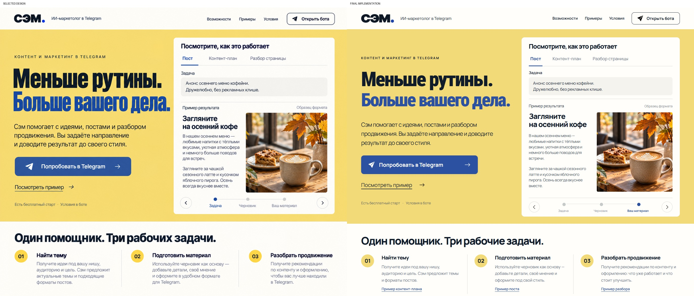
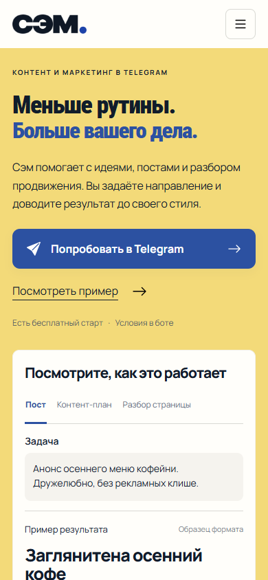
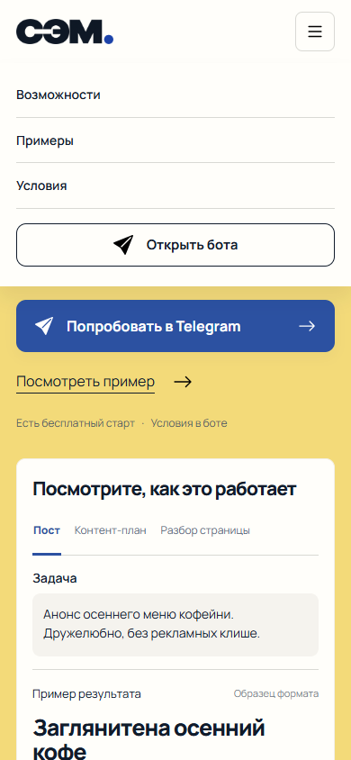
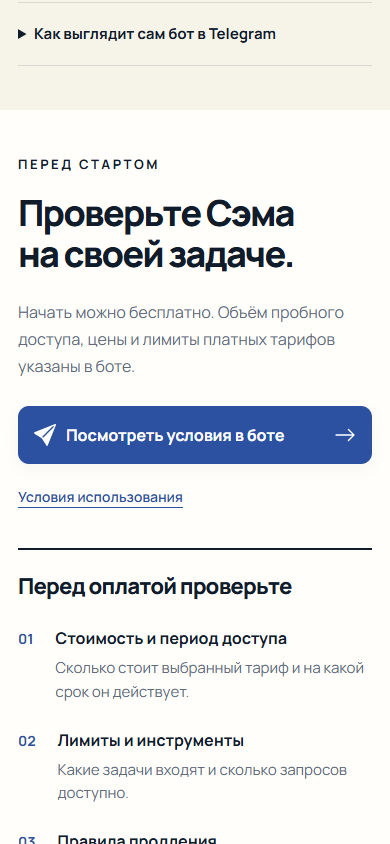
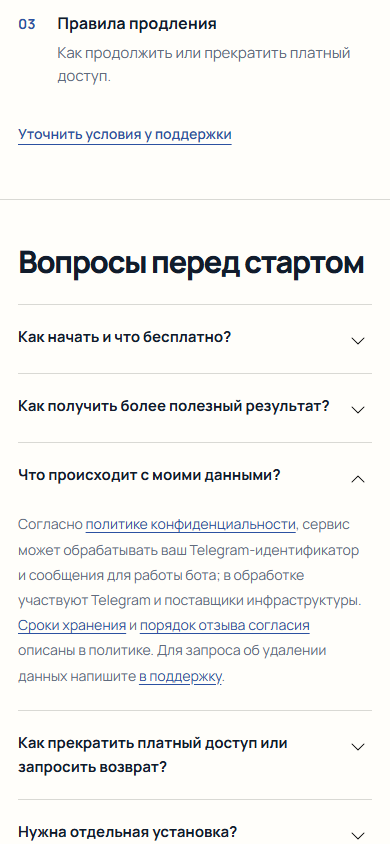

# Product Design — проверка редизайна Сэма

Дата: 18.10.2026. Область: внешний вид по согласованному эскизу и путь «понять пользу → посмотреть пример → открыть Telegram». Это проверка сайта, не работающего бота и не доказательство роста конверсии.

## Визуальные источники и нормализация

- Source visual truth: [qa/selected-design.png](qa/selected-design.png), последний выбранный пользователем эскиз. 1374 × 1145 px, без браузерной рамки.
- Implementation screenshot: [qa/redesign/final-1374.png](qa/redesign/final-1374.png), браузерный рендер локального `dist/` в Edge. CSS viewport 1374 × 1145, deviceScaleFactor 1, светлая тема, локальные шрифты загружены, prefers-reduced-motion: reduce для стабильного снимка.
- Состояние: вкладка «Пост», этап «Ваш материал», меню закрыто. У эскиза ошибочно выделена «Задача» при показанном готовом результате; в реализации выбран соответствующий содержимому этап.
- Полная сверка в одном изображении: [comparison-final.jpg](qa/redesign/comparison-final.jpg). Две колонки по 1374 × 1145, служебные подписи сверху 30 px. Масштаб исходных половин 1:1, растяжения и разной плотности нет.
- Фокусная сверка [заголовка](qa/redesign/comparison-headline.jpg) и [панели](qa/redesign/comparison-demo.jpg) выполнена попарными кропами одинаковых координат. Открыта и проверена наряду с полной композицией.
- [Мобильная версия](qa/redesign/mobile-first-screen.png): CSS 390 × 844, DPR 1. Для мобильного вида отдельного согласованного макета нет; проверены адаптация и работоспособность, а не буквальное совпадение с несуществующим макетом.

## История сравнения и исправления

1. Первая сверка, результат blocked: [P1] длинная синяя строка заголовка выходила из левой колонки; [P2] панель была около 737 px вместо 703 px и увеличивала первый экран; [P2] задача теряла заданные переносы, вкладки расходились слишком широко. Исправлены размер второй строки, отступы, ритм панели, выравнивание табов и `white-space: pre-line`.
2. После исправления: заголовок не пересекает панель, в исходном состоянии панель занимала 702.25 px, нижняя граница hero — 848.25 px против примерно 849 px в эскизе. Более ранние промежуточные скриншоты не архивировались отдельно; они не выдаются за сохранённые доказательства.
3. Проверка дополнительных состояний выявила [P2] изменение высоты при переключении: до 76.1 px на 1024 и 18.6 px на 320. По измеренному максимальному содержимому установлена минимальная высота панели на соответствующих диапазонах ширины. Финальные девять состояний на каждом из восьми экранов имеют разницу высоты 0 px.
4. Финальная повторная визуальная сверка: [comparison-final.jpg](qa/redesign/comparison-final.jpg), оба фокусных сравнения и мобильные состояния открыты и проверены. Панель теперь 711.75 px — примерно на 9 px выше эскиза; это сознательный запас для работающих примеров без сдвига страницы. Такая разница не меняет композицию первого экрана. Открытых исправимых P0/P1/P2 в проверенной реализации нет.

## Пять поверхностей соответствия

| Поверхность | Оценка и подтверждение |
|---|---|
| Шрифты и типографика | Локальный Manrope для текста и Roboto Condensed 900 для заголовка. Проверено фактическое наличие загруженного шрифта, переносы и отсутствие переполнения. Растровый эскиз не содержит имени исходного display-шрифта; живой заголовок менее вытянут и тяжёл. [P3] При появлении брендового шрифта можно уточнить рисунок. Иерархия и двухстрочное расположение сохранены. |
| Отступы и ритм | Сохранены двухколоночный hero, широкие поля, белая панель и три плоские колонки ниже. Панель чуть выше ради стабильного переключения. На телефоне CTA идёт перед примером. Основные регионы не перекрываются. |
| Цвета и токены | `--yellow: #f3da79`, `--blue: #2c51a1`, `--ink: #111c2b`, `--paper: #fffefa`. Мягкий жёлтый и синий сохраняют выбранный баланс; градиентная текстура эскиза заменена ровной заливкой. На основных синих кнопках белый текст, состояние фокуса различимо. |
| Качество изображений | Отдельная фотография coffee.webp и прозрачный sam-wordmark.png созданы по арт-направлению выбранного макета. Это контентные изображения, интерфейс остаётся HTML. Кадр и кружка немного отличаются от сгенерированного эскиза; нет растяжения, ореолов или замены фото CSS-рисунком. Иконки Bootstrap Icons, MIT. |
| Тексты | Сохранены ключевой заголовок и смысловые блоки. Демонстрации явно отмечены как образцы формата. Показан результат вместо неработающей формы; нет вымышленных отзывов, цен или гарантий продаж. Ниже первого экрана структура расширена под рабочий сайт, поскольку эскиз обрывается после трёх задач. |

## Повторный аудит пути посетителя

1. **Первый экран — работает.** Понятны тип инструмента, польза, Telegram как место работы и основная кнопка. CTA целиком видна в исходном viewport на всех восьми проверенных экранах. Фото и демонстрация следуют за оффером на телефоне.

   

2. **Примеры и навигация — работают.** Пост, контент-план и разбор переключаются кнопками и с клавиатуры; этапы — также свайпом внутри панели. Нет автоматического перелистывания. Все три сценария и три этапа проверены на восьми ширинах. Мобильное меню содержит запуск бота и закрывается по выбору пункта и Escape.

   

3. **Условия перед запуском — доступный интерфейс, нужны факты владельца.** Есть явный переход к тарифам бота, оферта и поддержка. Цена, бесплатные лимиты и наличие/отмена автопродления не подтверждены; это остаётся открытым вопросом контента из [QUESTIONS.md](docs/QUESTIONS.md). Для окончательного выпуска нужны точные условия. Произвольные числа не добавлены.

   

4. **Вопросы и повторный CTA — работают.** Ответы раскрываются, политика и поддержка доступны по ссылкам. В конце страницы есть повторный запуск без необходимости возвращаться наверх. Сведения об обработке данных пересказывают опубликованную политику; фактическую серверную обработку проверка сайта не подтверждает.

   

## Поведение, доступность и границы проверки

368 успешных проверок; viewport 320, 360, 390, 457, 768, 1024, 1374, 1440 px. Нет горизонтального переполнения, ошибок JavaScript или отсутствующих ресурсов. Проверены ARIA-состояния вкладок, Arrow/Home/End, меню, свайпы, нативный диалог с Escape и возвратом фокуса, копирование запроса, локальные ресурсы/якоря, юридические страницы и статический пример без JavaScript.

Анимации переключения 220 ms и появления блоков 400 ms; контент не скрыт до запуска JavaScript. Системный reduced-motion отключает движение. Основные кнопки на телефоне доступны для касания. Полная WCAG-сертификация и тест реальным скринридером не выполнялись.

Аналитика отключена до явного согласия, на предпросмотре исходные счётчики не запускаются. Сценарий основного домена проверен перехватом запросов: после согласия появляются два счётчика, один клик отправляет одно событие, отзыв согласия останавливает загрузку после перезагрузки. Реальная телеметрия при тестах не передавалась.

Telegram-ссылки и исходные start-параметры сохранены; работа бота, покупка, отмена подписки и фактическая конверсия не проверялись. Честные примеры формата следует заменить реальными ответами после получения материалов владельца.

## Чеклист

- [x] Сопоставить эскиз и браузерный рендер в одном изображении, включая читаемые фокусные фрагменты.
- [x] Исправить переполнение, ритм панели и сдвиг при переключении; повторить сравнение.
- [x] Проверить мобильную версию и ключевые интерактивные состояния.
- [x] Сохранить воспроизводимый тест: `python qa/check_site.py`.
- [ ] Получить от владельца реальные лимиты, тарифы, правила продления и образцы ответов — за пределами доступной реализации.

final result: passed
